# cost-oracle

**Predict the cost of an AI request before you spend it.**

A skill for GitHub Copilot CLI and Claude Code that estimates what a task will
cost — in **USD for Claude** (token-based, priced at published API rates) and in **AIC for GitHub
Copilot** (AI credits, read from Copilot's own per-request records) — trained
on _your_ session history, with a feedback loop that makes it more accurate
over time.




_Animated replay of a real session — full unedited output in
[`demo/demo.md`](demo/demo.md)._

## How it works

```
 1. TRAIN                      2. ESTIMATE                   3. FEEDBACK
 ┌─────────────────────┐       ┌─────────────────────┐       ┌─────────────────────┐
 │ Scan local session  │       │ task + model +      │       │ "it actually cost   │
 │ history:            │  ──▶  │ complexity tier     │  ──▶  │  $11.42"            │
 │ · Claude Code       │       │   ▼                 │       │   ▼                 │
 │   (exact tokens)    │       │ expected cost +     │       │ calibration factor  │
 │ · Copilot CLI       │       │ low–high range +    │       │ updates; future     │
 │   (AIC per request) │       │ budget verdict      │       │ estimates improve   │
 └─────────────────────┘       └─────────────────────┘       └─────────────────────┘
```

1. **Training round** — `cost-oracle train` scans local session history and
   builds a baseline corpus of distribution summaries (percentiles only, never
   conversation content):

   | Provider | Source                         | Signal                                                                                         |
   | -------- | ------------------------------ | ---------------------------------------------------------------------------------------------- |
   | Claude   | `~/.claude/projects/*/*.jsonl` | Exact per-request token usage (input, output, cache read/write), priced at published API rates |
   | Copilot  | `~/.copilot/session-store.db`  | Per-request AIC spend (`total_nano_aiu`), per model                                            |

2. **Estimation** — a task is mapped to a complexity tier, each tier anchored
   to a percentile of _your_ observed sessions:

   | Tier       | Anchor | Typical meaning                        |
   | ---------- | ------ | -------------------------------------- |
   | `quick`    | p10    | one-liners, single lookups             |
   | `simple`   | p25    | small single-file edits                |
   | `moderate` | p50    | a typical feature or bug fix (default) |
   | `complex`  | p75    | multi-file refactors with tests        |
   | `epic`     | p90    | migrations, audits, greenfield builds  |

   For **Claude**, the corpus's tokens-per-request distribution is priced at
   the _requested_ model's rates — so you can ask "what would this cost on
   Haiku instead of Opus?" even if you've never run Haiku. For **Copilot**, the
   per-request AIC distribution for that model is used directly. Every estimate
   includes a low–high range and is saved with a short id.

3. **Feedback** — report the actual cost later and a per-provider calibration
   factor updates (exponentially-weighted, in log space, clamped) so systematic
   over- or under-estimation corrects itself. `cost-oracle status` shows the
   running accuracy (MAPE).

## Install

Requires Python 3.10+ (standard library only — no pip installs).

### Option A — GitHub Copilot CLI plugin (recommended)

Run these commands in GitHub Copilot CLI. They also work in Claude Code:

```
/plugin marketplace add johnhain-msft/ai-cost-oracle
/plugin install cost-oracle@ai-cost-oracle
```

GitHub documents these commands in
[Finding and installing plugins for GitHub Copilot CLI](https://docs.github.com/en/copilot/how-tos/copilot-cli/customize-copilot/plugins-finding-installing).

Start a new session in your chosen client, then run the training round once:

```
/cost-oracle train
```

### Option B — manual install (Claude Code only)

The Bash installer copies the agent and skill into `~/.claude`; it does not
configure GitHub Copilot CLI. For Copilot CLI, use Option A.

```bash
git clone https://github.com/johnhain-msft/ai-cost-oracle.git
cd ai-cost-oracle && ./install.sh
```

Start a new Claude Code session, then run:

```
/cost-oracle train
```

## Use it

### Conversationally (skill)

```
How much will it cost to add OAuth login to my Next.js app on Opus?
Estimate refactoring the payment service in Copilot — I have 1,000 AIC left.
That OAuth estimate? It actually cost $11.42.
```

In Claude Code, you can also constrain **what the estimate itself may cost and
which model produces it** — the skill delegates to the `cost-oracle` agent with your model
choice and holds it to budget mode (status check + one estimate call, no
exploration):

```
Estimate this migration, but spend at most $0.05 on the estimate and use Haiku.
```

### Directly (CLI)

From a local clone of this repository (Bash, independent of either client):

```bash
alias cost-oracle='python3 skills/cost-oracle/scripts/cli.py'

cost-oracle train                      # (re)build the baseline corpus
cost-oracle estimate --provider claude --model claude-opus-5 \
    --task "Add OAuth login" --complexity moderate --budget 15
cost-oracle estimate --provider copilot --model claude-opus-5 \
    --task "Refactor payments" --complexity complex
cost-oracle feedback f73ee3a7 --actual 11.42
cost-oracle status                     # corpus + calibration + accuracy
cost-oracle models                     # known Claude pricing
```

`estimate --budget X` exits with code `2` when the expected cost exceeds the
budget, so it composes with shell scripts and CI gates.

## Privacy

Everything runs locally. Training reads your session history **read-only** and
stores only statistical summaries (counts and percentiles) under
`~/.cost-oracle/`. No prompt text, no file contents, no network calls.

## Accuracy, honestly

These are baseline-and-calibration estimates, not invoices. Expect the first
estimates to be rough — the range matters more than the point value — and
expect them to tighten as you feed back actual costs. Session-level baselines
exclude trivial one-shot sessions so background noise doesn't drag the task
size toward zero.

## Repository layout

```
agents/cost-oracle.md            # the agent (cost-prediction specialist)
skills/cost-oracle/SKILL.md      # the skill (conversational entry point)
skills/cost-oracle/scripts/      # the engine: train / estimate / feedback CLI
.claude-plugin/                  # plugin + marketplace manifests
tests/                           # pytest suite (30 tests)
demo/                            # real captured session + walkthrough
install.sh                       # manual installer
```

## Development

```bash
python3 -m pytest tests/ -v
```

## License

[MIT](LICENSE) © 2026 John Hain
